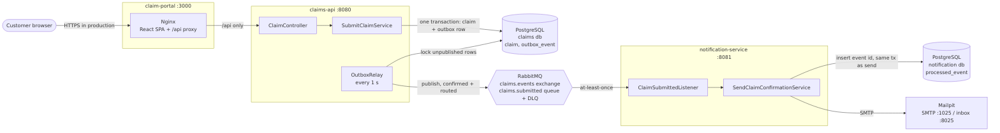
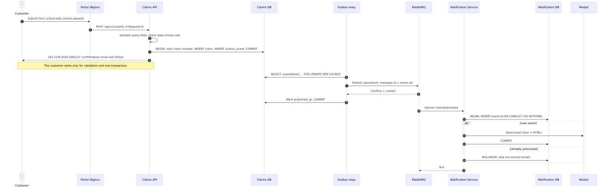

# Architecture overview

This page describes the solution as built. The reasoning behind individual decisions, including
the alternatives rejected, is in [`adr/`](adr/README.md).

## In one paragraph

A customer submits a claim in a React portal. The Claims API validates it, gives it a claim number,
and saves the claim and a `ClaimSubmitted` event in one database transaction, then answers at once.
A relay inside the Claims API publishes the event to RabbitMQ. A separate Notification Service
consumes it, sends one confirmation email containing the claim number, and records the event as
processed. Email never happens on the customer's request; a saved claim always ends in one email or
in a dead-letter queue that operations can see and replay.

## Components



| Component | Technology | Owns |
|---|---|---|
| `claim-portal-ui` | React 19, TypeScript, Vite; Nginx in the container | Form, client-side validation, confirmation page |
| `claims-api` | Spring Boot 3.5, Java 21, JPA, Flyway | Validation, claim numbers, `claim` and `outbox_event` tables, publishing |
| `notification-service` | Spring Boot 3.5, Java 21, JDBC, Flyway, Thymeleaf | Its queue and DLQ, `processed_event` table, email rendering and sending |
| `openapi/claims-api.yaml` | OpenAPI 3.1, in `claims-api` resources | The HTTP contract; server interface, models and portal types are generated from it (ADR-0010) |
| `event-contracts` | Plain Java, no framework | `ClaimSubmittedEvent` v1 and broker names: the only shared code |
| PostgreSQL 16 | One database and login per service | |
| RabbitMQ 4.1 | Topic exchange, durable queues, dead-lettering | |
| Mailpit | SMTP capture with a web inbox | |

## The claim, step by step



## What happens when things fail

| Failure | Behaviour | Where |
|---|---|---|
| Invalid input | 400 problem+json, one error per field, nothing saved or published | `ClaimRequestValidator`, `GlobalExceptionHandler` |
| Database down | API is not ready (readiness includes `db`); requests fail with a generic 500 and a reference | Actuator readiness group |
| Broker down at submit time | Claim still accepted; outbox row waits; relay retries every second | `OutboxRelay`, ADR-0002 |
| No queue bound yet | Not marked published (mandatory + returns); retried until the consumer has declared its queue | `RabbitOutboxEventPublisher` |
| Notification Service stopped | Messages wait in the durable queue; emails go out when it restarts | |
| Same submission sent twice (retry, refresh, double-click) | With the same `Idempotency-Key`: the original 201 and claim number, marked `Idempotent-Replayed`; no second claim, event or email. Same key, different claim: 409 | `SubmitClaimService`, `JdbcIdempotencyStore`, ADR-0011 |
| Customer reports the same incident again | Accepted as a new claim, flagged `possible_duplicate_of` the first one for the claims team; the flag is never shown to the caller | `SubmitClaimService`, ADR-0011 |
| Event delivered twice | One email; the second delivery is skipped | `JdbcProcessedEventStore`, ADR-0003 |
| SMTP down | 3 attempts with exponential backoff, then dead-lettered; the processed row rolls back, so a replay still sends | `MessagingConfiguration`, `SmtpOutageIntegrationTest` |
| Malformed or unknown-version event | Straight to the DLQ, no retries | `ClaimSubmittedListener`, `NonRetryableEventException` |
| Crash after SMTP accepted, before commit | One duplicate email on redelivery: an accepted, documented limitation | ADR-0003 |

Messages in `claims.submitted.dlq` keep their headers plus RabbitMQ's `x-death` record. After the
cause is fixed they can be moved back to `claims.events` (for example with the management UI's
shovel) and are processed normally.

## Inside each service

Both services use ports and adapters (hexagonal architecture). Arrows point the way dependencies go;
the domain depends on nothing.

```text
adapter.in.web / adapter.in.messaging     (HTTP controller, RabbitMQ listener)
        │
        ▼
application  (use case)  ──────────►  application.port.out  (interfaces)
        │                                     ▲
        ▼                                     │ implemented by
domain   (records, rules; no Spring)    adapter.out.*  (JPA/JDBC, RabbitMQ, SMTP, Thymeleaf)

config   wires plain-Java use cases to adapters and wraps them in decorators:
         transaction (TransactionTemplate) and metrics (Micrometer)
```

- The HTTP adapter is generated from the contract: `ClaimController` implements the generated
  `ClaimsApi`, and `ClaimApiMapper` turns the generated models into domain objects straight away,
  so the domain never depends on generated code.
- Use cases are plain Java with constructor injection, so the main business tests need no Spring,
  database or broker. Spring annotations stay in adapters and `config`.
- Patterns: transactional outbox, idempotent consumer, ports and adapters, strategy
  (`ClaimNumberGenerator`, `EmailSender`, `OutboxEventPublisher`), decorator (transactions, metrics),
  template (Thymeleaf email), immutable records for DTOs, events and value objects.

## Security and personal information

- No secrets in the repository. Compose and application defaults are local-only values
  (`local-dev-only`); real values come from environment variables or a `.env` file, which is
  gitignored. CI runs a gitleaks scan.
- Personal information is kept out of logs: claim numbers and correlation IDs are logged, email
  addresses are masked (`j***@example.com`), domain objects override `toString()`, and the
  dead-letter path logs no message bodies. Error responses never echo submitted values.
- The event carries only what the email needs (ADR-0005).
- Input: server-side validation is authoritative; unknown JSON fields are rejected; 64 KB body
  limit at the edge and in the API; Thymeleaf escapes all values in HTML email; email addresses are
  checked for header injection; incoming correlation IDs are restricted to safe characters.
- Containers run as non-root. Only the portal is meant for customers; the edge proxies `/api/` only.
- Not in scope locally: TLS, authentication, rate limiting. See the README's production list.

## Observability

- Correlation ID: created at the edge (or taken from a valid `X-Request-Id`), logged by the API,
  stored with the outbox row, sent as the `x-correlation-id` message header and logged by the
  Notification Service. One ID follows a claim from the browser to the email.
- Logs: readable text locally; JSON (Elastic Common Schema) in containers, with `correlationId` as a field.
- Health: `/actuator/health/readiness` drives Compose start order. The API's readiness excludes
  the broker on purpose, so a broker outage does not stop claims being accepted.
- Metrics at `/actuator/prometheus`: `claims_submitted_total`, `outbox_backlog`,
  `notification_emails_total{outcome}`, `notification_dead_lettered_total`. The two to alert on are a
  growing `outbox_backlog` and any increase in `notification_dead_lettered_total`.

## Deployment

| Container | Image | Port | Production equivalent |
|---|---|---|---|
| claim-portal | Nginx (unprivileged) serving the build | 3000 | CDN or static hosting behind a WAF |
| claims-api | Spring Boot on JRE 21 Alpine | 8080 | 2+ replicas behind a load balancer |
| notification-service | Spring Boot on JRE 21 Alpine | 8081 | Replicas scaled on queue depth |
| postgres | PostgreSQL 16 | 5432 | Managed PostgreSQL, backups, encryption at rest |
| rabbitmq | RabbitMQ 4.1 with management | 5672 / 15672 | Managed or clustered broker |
| mailpit | Mailpit | 1025 / 8025 | Transactional email provider |

The relay is safe to run on several API replicas (`SKIP LOCKED`), and Notification Service
instances are competing consumers on one queue, so both sides scale horizontally.
